_This is a repost from my company's [engineering
blog](https://careers.celonis.com/blog/multi-tenant-customer-managed-encryption-keys).
Same content, different layout. Opinions and voice my own._

Tell me you work with enterprise customers without telling me you work with
enterprise customers: Customer-Managed Encryption Keys (**CMEK**). If you know
this acronym, welcome! This is a compliance topic, and I know that these are
second in boredom only to German tax law, but I found some interesting lessons
that apply more generally, so here we are.

I currently work at Celonis, a SaaS platform to derive business insights for
customers based on their process data. Customers of such a platform are
(understandably) very protective about their data, and (therefore) *love* CMEK.
The link between the two is not immediately obvious, and would take a long post
on its own to explain clearly, but allow me to say that *internal* risk
management, procurement, governance and audit policies often have a blanket "all
data stores must use keys we control" statement somewhere. CMEK solves for that
need.

In a nutshell, CMEK gives customers the ability to encrypt their data **at
rest** with a key they control, while allowing Celonis (the SaaS provider) to
store that data. This keeps the data with the provider, and gives customers two
features: independent **rotation** and **revocation** of the encryption key.
Besides compliance, deleting their key allows them to [permanently
wipe](https://en.wikipedia.org/wiki/Crypto-shredding) their data, independently
of the provider.

But CMEK is not the only compliance control they care about. More often they
need to comply with standards and regulations specific to their industry: HIPAA,
ISO 27001, SOC, etc. So, why am I focusing on CMEK instead? It's because this is
the feature that I found most difficult to offer efficiently in a multi-tenant
platform. This post is about how we reduced both cost and time to provision CMEK
tenants (i.e. customers) in the Celonis Platform **by 10x**, while preserving
the same CMEK guarantees. You will see some of the design decisions, tradeoffs
and problems we faced to get there.

# How it was before

All major cloud providers provide this feature out of the box, and since
encryption at the cloud infrastructure level is the easiest to implement, and to
explain to a customer, this is how we were implementing it.

For the rest of the article, I will use AWS terminology for simplicity, but
everything here applies to Azure too (and as an extension, other hyperscalers
like GCP).

For example, on AWS, Celonis runs on top of [Kubernetes](https://kubernetes.io)
and stores all data on [S3](https://aws.amazon.com/s3/),
[RDS](https://aws.amazon.com/rds/) and [EBS](https://aws.amazon.com/ebs/), and
all three support CMEK out of the box. The customer creates a
[KMS](https://aws.amazon.com/kms/) key **in their own AWS account**, and
authorizes a Celonis account to **use** it. We provision _a full_ Celonis
instance in a new account, dedicated to that customer ([Silo
Model](https://docs.aws.amazon.com/solutions/multi-tenant-architectures-on-aws/)),
and configure data stores to use that key to encrypt data at rest. Easy to do
and to explain. Certifications and documentation are available from AWS itself,
so discussions with customers' security and IT departments are much easier.

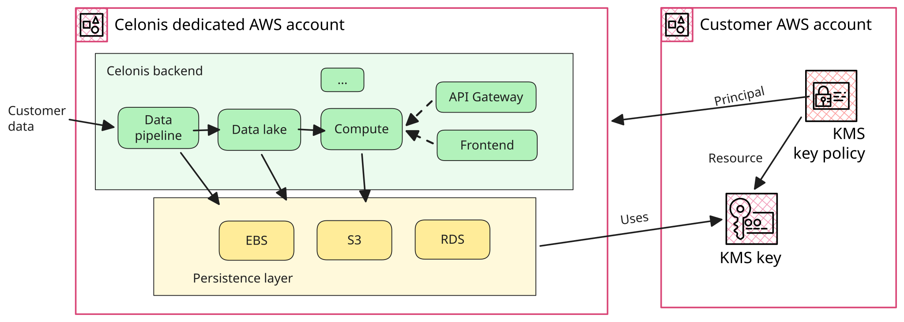

There are two main problems with the solution: time to provision, and cost.

Celonis serves very bursty workloads: dedicating VMs and databases to a single
customer means provisioning for a peak that happens a few times a day at most,
while being idle the rest of the time. Autoscaling alleviates this, but not
below a safe minimum, which is still expensive for us. And given that Celonis is
a complex piece of software composed of about a hundred services, micro-services
and databases that keep evolving, provisioning is not easily automated, meaning
it can take several weeks to set up for a single customer.

Celonis, however, is natively multi-tenant with a [Pool
Model](https://docs.aws.amazon.com/solutions/multi-tenant-architectures-on-aws/),
which means that tenants (i.e. customers) are separated at the metadata level,
and all resources (storage, databases and compute) are shared. Besides cost, an
advantage of not requiring per-tenant infrastructure is fast, automated tenant
provisioning. The problem is that shared infrastructure can only be encrypted
with a single key, and therefore can only serve a single CMEK customer. So, even
though we do host multiple customers in the same instance by default, we can't
do it for the ones that require dedicated encryption keys.

Note how we were basically stuck between two extremes: either the efficient
_Pool Model_, multi-tenant architecture without CMEK, or an inefficient
single-tenant _Silo Model_ for CMEK customers. Each served the needs of some,
but a large fraction of customers fell in between, wanting the security
guarantees of CMEK, but not the cost and time overhead of a single-tenant
solution.

# What we wanted

The goal of the project was to port CMEK guarantees from single-tenant to
multi-tenant environments. Each customer would still have their own isolated
view of the product, but become a tenant in an existing environment and **no
longer require** a dedicated instance: higher data protection standards together
with cost efficiency.

The 10x savings goal compares what it costs us to serve a CMEK customer as a
tenant in a shared environment with a dedicated instance for the same customer,
counting raw infrastructure costs only. Most of that cost comes from compute,
and most of the provisioning time from standing it up and configuring backends.
Since multi-tenant environments _were already_ two orders of magnitude cheaper
to run, and provisioned tenants in minutes rather than weeks, we didn't need to
match them: we only had to keep most backends multi-tenant and add just a few
steps to the existing tenant provisioning workflow.

Besides the stated goal, we had several additional constraints:

- We could not stop every internal development team (about a hundred) and ask
  them to overhaul the way they were storing data.
- We had to implement it reasonably fast (i.e. not a ten-year project).
- It needed to work on all major cloud providers.
- It had to respect the tradeoffs backend services made in choosing one type of
  storage instead of another. We couldn't, for example, further limit throughput
  in S3, or break Postgres queries that relied on filtering rows.
- We wanted to increase reliability as a side effect, whenever possible.

In terms of scaling, we targeted an order of **100 CMEK tenants per
environment**, and no more. This gave us enough headroom for a few years, while
keeping the problem space manageable.

# First step: Metadata Platform layer

Since most Celonis backend services store data, the CMEK problem was a problem
for all of them. Solving it as things stood back when we started would have
meant fanning out work to most teams and paying a huge coordination and auditing
cost.

To decrease the cost of this and similar data-related initiatives, the Metadata
Platform (MP) group, of which I'm part, was born. Like any other Internal
Developer Platform
([IDP](https://internaldeveloperplatform.org/what-is-an-internal-developer-platform/))
provider, we're serving the needs of two kinds of customers: the company's
(users of Celonis), and internal ones (Celonis engineers using our services).
I'm mentioning this because balancing these two needs was one of the critical
aspects of the project.

To avoid coordination costs, as a first step, we introduced a layer between
backends and their data stores to centralize data persistence concerns, instead
of keeping them scattered across all backends. We took over maintenance of some
existing pieces (e.g. libraries) and introduced some more (e.g. the proxies
you'll see later), so we could evolve them together.

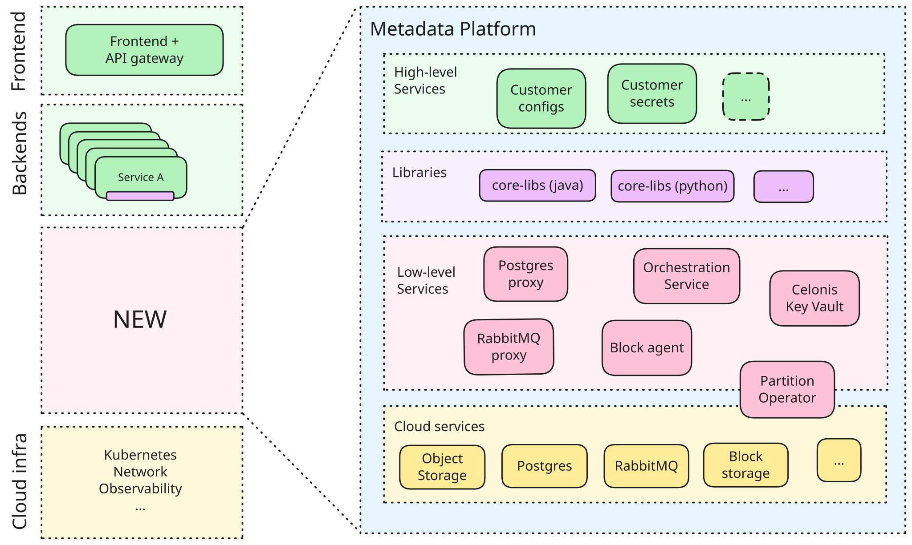

Meeting our internal users where they were was the key to success. Most services
were using client-side Java or Python libraries, which we could change
underneath a stable API. This allowed us to carry out the migration centrally by
sending relatively simple PRs to the affected backend teams, instead of asking
them to change how they were using storage. Of course, not all teams were able
to use the new layer easily, so we also built escape hatches and exceptions on
top. The important part was that the **majority** of the migrations were low
effort, so we could focus on the long tail.

# Second step: Encryption

Our ideal target architecture was to use a "proxy encryption" model: inject some
proxies between backends and their data stores and from there, transparently
encrypt / decrypt data, depending on the tenant being served by that request,
without changing backends or cloud services.

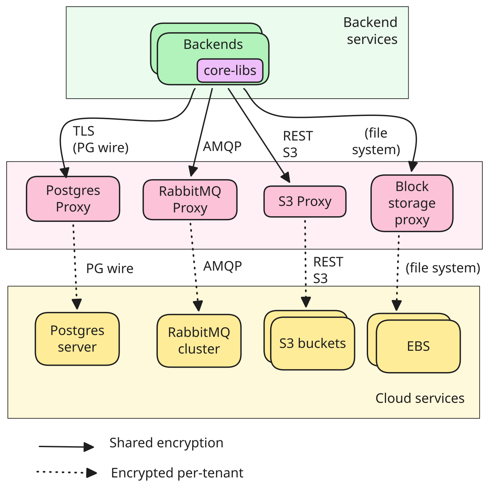

This would have fully preserved a _Pool Model_ multi-tenant architecture (i.e.
infrastructure is shared among tenants), at the cost of one extra hop between
backends and storage, and an implementation of one transparent proxy per storage
type. Those **proxies would need to be indistinguishable** from the actual
storage they are proxying, which would have meant reimplementing the S3 API, the
Postgres protocol, the AMQP protocol, and a filesystem-like protocol.

An alternative ideal solution to the one above would have been to use a
variation of the AWS [Bridge
Model](https://docs.aws.amazon.com/solutions/multi-tenant-architectures-on-aws):
provision one set of cloud storage instances (what we call a **Partition**) for
each CMEK customer, and have proxies transparently **route requests** to the
corresponding one, depending on the tenant being served. We shall call this the
"proxy to bridge" model.

In practice, a partition is nothing more than a logical grouping of a set of
cloud provider storage instances (S3 buckets, RDS databases, etc.) dedicated to
a subset of tenants. In this model, each instance is provisioned multiple times
(one per partition), and encrypted with _some_ KMS key at the cloud provider
level. The key could either be managed by Celonis (the default), or by the
customers (CMEK).

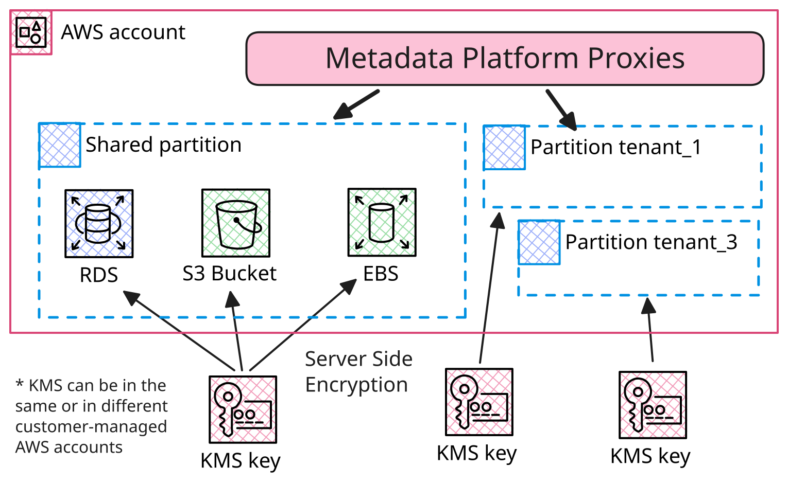

This could also be easily retrofitted to existing Celonis instances, by simply
making the existing data stores the "shared partition", and mapping all existing
tenants to it. Existing tenants need no migration, and new ones could either
decide to be onboarded to the shared (default) or to a new dedicated partition
for CMEK. This is why the shared partition hosts many tenants, while a dedicated
partition hosts a single CMEK tenant. Each tenant belongs to one and only one
partition.

In this model, encryption is handled at the cloud provider level, the same way
as in the single-tenant architecture, so it preserves its security standards
(e.g. [FIPS](https://aws.amazon.com/compliance/fips/)) and certifications, and
removes "encryption" from the list of direct responsibilities of the Metadata
Platform layer.

## Patterns {#patterns}

Both solutions above are conceptually nice, but unfortunately neither would have
worked alone for every storage type. A single unified architecture would have
imposed major changes on our internal and external customers, so we had to
instead adapt to the reality of each storage type.

The bottom of the stack ended up using a variation on these three basic
patterns, depending on **which component encrypts**, and **where it stores** the
data:

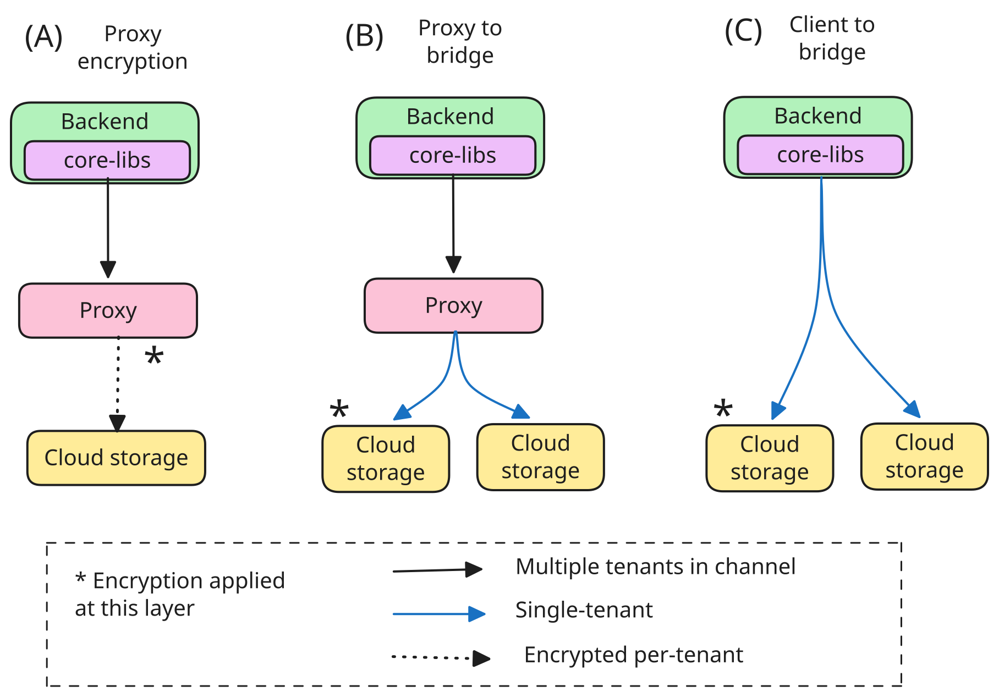

- **Pattern A**: the "proxy encryption" solution presented above.
- **Pattern B**: the "proxy to bridge" solution above.
- **Pattern C**: a client-side variation of _B_ we call "client to bridge".

I already briefly discussed solutions **A** and **B** in the previous section.
The last one **C** eliminates the proxy and routes requests from the application
side through a library. Encryption is still done at the cloud provider level,
but the application has to know which partition to use for each tenant.

Besides the bottom, also the top of the stack couldn't stay completely
unchanged, for either performance or compatibility reasons. We had to instead
divide backends into two categories:

- **Multi-tenant:** accessing storage through Metadata Platform proxies and
  libraries.
- **Single-tenant:** deployed and dedicated to a single tenant and accessing the
  underlying cloud storage partition directly.

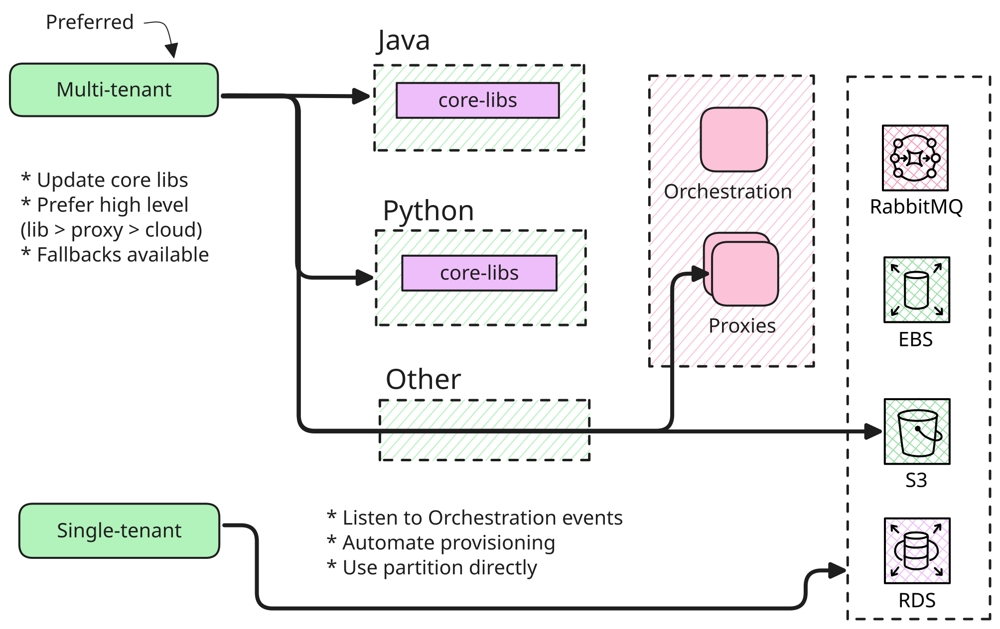

The first category was the vast majority (80%+), which required little to no
change, besides upgrading libraries and changing some configuration, as routing
happened transparently.

Routing for this second category still had to happen, but at the application or
service level. This sounds convoluted, but it was in fact pragmatic. For
example, with [Vertica](https://en.wikipedia.org/wiki/Vertica) (one of our data
lake solutions), it was already common practice to provide dedicated instances
for some customers (e.g. for performance reasons), and therefore routing already
existed for that component. We just had to use it for one additional reason. The
end result looked more like this:

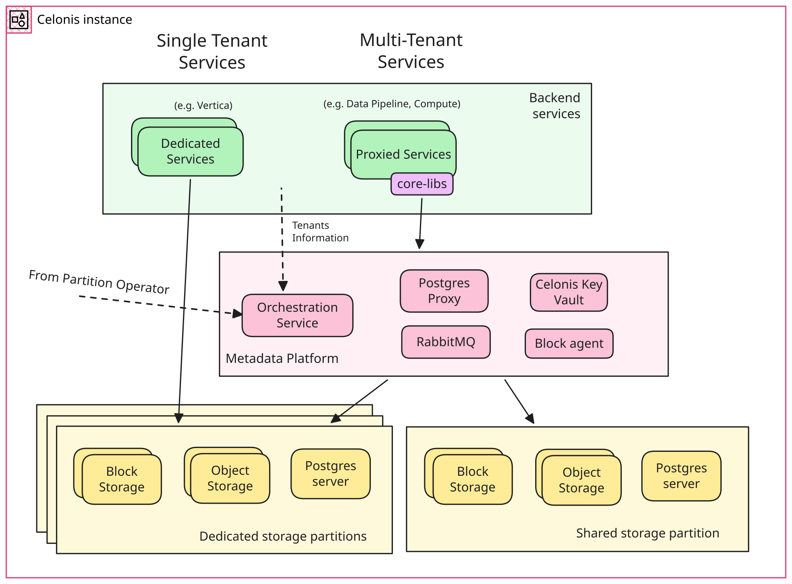

## Tenant isolation

Besides encryption, the whole solution depended on strong **tenant isolation**
properties, which answer the question: how to be sure that all data for a
particular tenant is separated and invisible to other tenants?

Celonis being natively multi-tenant, we didn't have to invent anything special
to identify tenants. We tapped into existing functionality of the ingress
gateway, which assigns a tenant ID to all authenticated requests through a
signed [JWT](https://en.wikipedia.org/wiki/JSON_Web_Token). All the RPC
libraries we use propagate this information automatically when services call
each other.

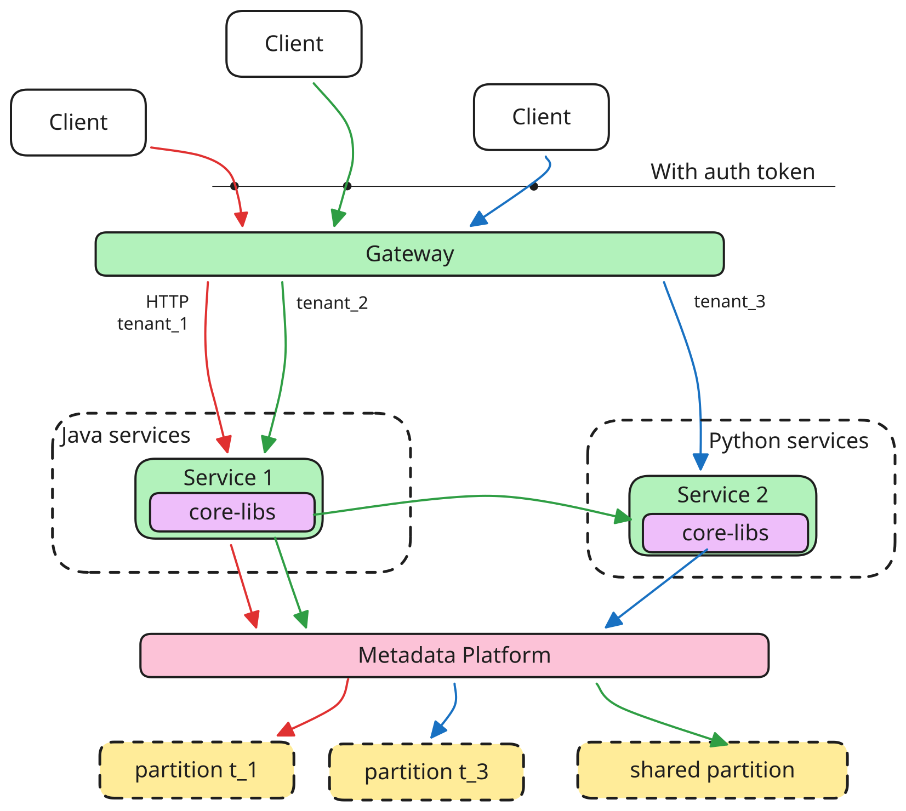

For example, the pre-existing Java core library, based on Spring Boot,
propagated the tenant ID from signed requests (in a [JWT
claim](https://auth0.com/docs/secure/tokens/json-web-tokens/json-web-token-claims))
into the
[SecurityContext](https://docs.spring.io/spring-security/reference/api/java/org/springframework/security/core/context/SecurityContext.html).
We therefore already had that readily available in our storage libraries. The
challenge we had to solve was how to propagate that information also through
storage native protocols, and not only HTTP / REST.

# Implementation

To do them justice, each component would need one or more posts on its own. Even
if not comprehensive, by going into some implementation details here, I hope to
clarify some of the choices and why the high-level overview looks complicated.

In summary, RabbitMQ and block storage used [Pattern A](#patterns), Postgres
used _Pattern B_, and Object Storage _Pattern C_.

## Celonis Key Vault {#key-vault}

[AWS
implements](https://docs.aws.amazon.com/whitepapers/latest/logical-separation/encrypting-data-at-rest-and--in-transit.html)
encryption at rest (or at least, the one we use) through KMS. When encrypting
some plaintext data, a data store uses a fresh data key, which is itself
encrypted by a KMS root key through [envelope
encryption](https://docs.aws.amazon.com/kms/latest/developerguide/kms-cryptography.html#enveloping).
The data store stores _both the encrypted data and the encrypted data key_
together. To decrypt the data, it needs to do the opposite. First, it sends the
encrypted data key to KMS, which uses the root key to decrypt it, and only then
is it able to use it to decrypt the actual data into its plaintext.

This double layer of encryption ensures protection against [key
wear-out](https://aws.amazon.com/blogs/security/the-curious-case-of-faster-aws-kms-symmetric-key-rotation/),
decouples root key usage from data encryption and also rotation from data
re-encryption. When a root key is rotated, all new data keys are encrypted with
the new version automatically. When it's revoked, all decrypt operations on data
keys start failing (within a few minutes), rendering the data they themselves
encrypted inaccessible.

The AWS storage services we rely upon use this mechanism out of the box. S3, for
example,
[uses](https://docs.aws.amazon.com/AmazonS3/latest/userguide/UsingKMSEncryption.html)
one data key per object. Besides using these services directly (for [Patterns B
and C](#patterns)), we also had to encrypt data in proxies for Pattern A. For
that, we implemented a simple _Celonis Key Vault_ (CKV) service, which wraps the
KMS APIs (or [Key Vault](https://azure.microsoft.com/en-us/products/key-vault)
in Azure). The service both abstracts away the cloud provider APIs (so that
consumers don't need to worry about which cloud they are running in), and also
provides a simple API to generate and decrypt _data keys_ based on the current
_tenant ID_. This ensures the correct customer key is used at all times.

The "root key" is what we refer to as the customer-managed key in CMEK: it's the
key under their control. Celonis doesn't have access to the key itself and can
only "use" it through creating and decrypting data keys through AWS services, or
Celonis Key Vault.

When encrypting some data, services like [RabbitMQ](#rabbitmq) and the [Block
Agent](#block-storage) request data keys from Celonis Key Vault, which in turn
depends on KMS. They follow the same process: encrypt data through fresh data
keys, store their encrypted versions, and use CKV to decrypt them. We ensure
that revocation and rotation have bounded delays by using new data keys for new
data and periodically reloading (every few minutes) and re-encrypting (every
day) existing data keys. Given their small size, this is cheap to do and brings
us in line with what AWS provides.

## RabbitMQ {#rabbitmq}

Backend services make heavy use of [RabbitMQ](https://www.rabbitmq.com/) (RMQ)
for message passing (1000+ queues, 250 msg/s per instance), and we're
self-hosting a few clusters for each Celonis environment. Given that messages
contain user data and can stay queued for an unpredictable time, we also had to
find a solution for encrypting them at rest.

To solve that, we applied [Pattern A](#patterns) cleanly: a transparent AMQP
proxy that encrypts the body of messages dynamically before sending them to the
existing RMQ clusters. The proxy behaves the same as a regular RMQ instance, as
it speaks the same protocol, but only encrypts / decrypts messages on the fly,
based on the tenant context (extracted from security context and passed along
with each [message](https://www.rabbitmq.com/tutorials/amqp-concepts#messages)
by the client). It delegates all functionality to the actual RMQ instance, which
at this point can store the data the way it wants (as it's already encrypted
correctly). This required minimal changes to client-side libraries, didn't
suffer from any of the problems discussed below and also improved connection
counts toward the RMQ cluster.

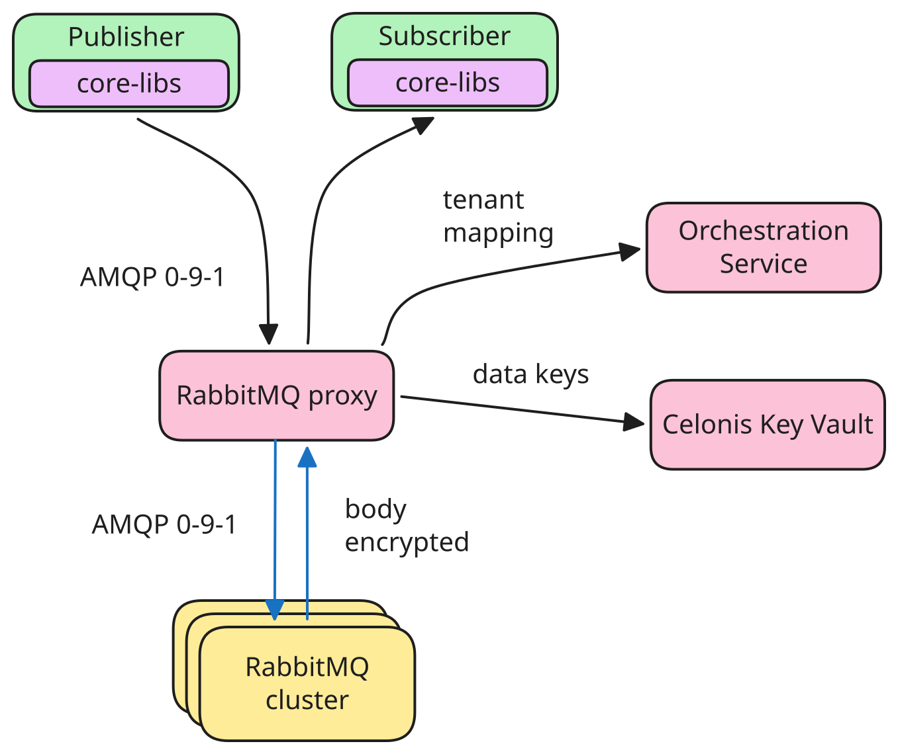

To understand which tenants require encryption, and map them to their encryption
key, the proxy uses the [Orchestration service](#orchestration-automation)
(described later), and [Celonis Key Vault](#key-vault) for the data encryption.
To reduce latency, data keys are generated every few minutes (still respecting
key rotations), instead of for every message. After a key revocation, queues'
consumers stop being able to process messages after caches expire.

Before committing to this solution, we also considered "simpler" variations. For
example, removing the proxy, and using one
[vhost](https://www.rabbitmq.com/docs/vhosts) per partition, making sure data
for each is stored in a separate directory, and each directory encrypted
separately with a per-tenant key. For encryption we hoped we could reuse the
[block storage solution](#block-storage) and for routing, pre-existing
client-side libraries in backends would have set the appropriate `vhost` based
on the tenant security context.

We discarded this for multiple reasons. The biggest was that not all queue types
split storage per vhost. A notable example is [quorum
queues](https://www.rabbitmq.com/docs/quorum-queues) we heavily depend on, which
store a unified write-ahead log (WAL) per node, shared by all queues. This meant
we couldn't cleanly separate data per-vhost, and to solve this, we would have
had to use [classic queues](https://www.rabbitmq.com/docs/classic-queues) only
(unthinkable), or fork RMQ to use split WALs per vhost, which seemed a high
risk, high maintenance proposition.

A second issue with the approach is that a listener (the receiving end) is tied
to one vhost. The [AMQP 0-9-1](https://www.rabbitmq.com/tutorials/amqp-concepts)
protocol picks its vhost once during connection opening, and doesn't allow
changing it afterward. Channels and consumers belong to a connection and there's
no way to subscribe to a queue "across every `vhost`". Besides duplicating all
queues, exchanges and bindings, this implies that every backend would have to
open one connection per queue, per partition, which would have meant a two
orders of magnitude increase in connections, which is a critical resource.

An alternative possibility would have been to use [Pattern C](#patterns): split
into multiple RMQ clusters and dynamically route messages based on the tenant at
the client side. This would have solved the storage problem (each instance would
have been single-tenant and used native EBS encryption) and connection
multiplicity at the RMQ side, but not at the receiving end. This would also have
been complicated to implement (fat client-side library in several different
languages) and increased maintenance and costs for RMQ clusters.

## Block storage {#block-storage}

Even though RabbitMQ didn't end up needing encryption at the block storage
level, the general problem was still present. Some backend services did use
block storage, mainly for caching or stashing intermediate data, and even though
this was a minority, it was an important one. These were the ones handling the
biggest data volumes and the most performance-sensitive. Two main examples are
Vertica (for data lake) and the "compute service" for serving data model
queries.

Our initial thought was to encrypt data from the application side before it hit
the disk. This was doable in our libraries, but not everywhere. For example, not
for Vertica (which is closed source and cannot use our libraries), nor for the
compute service, where it was not considered performant enough. Without getting
into too much detail, encrypting from the Java part of the service was deemed
too resource intensive, and doing it from the C++ part would not have been
reusable across services.

We therefore set out to implement a transparent solution following [Pattern
A](#patterns), based on
[fscrypt](https://docs.kernel.org/filesystems/fscrypt.html), which was both
performant and reusable. The main idea was to split the responsibility of
"asking for a tenant directory" from "encrypting it". The second part would
become a feature of the Kubernetes node a Pod would run in.

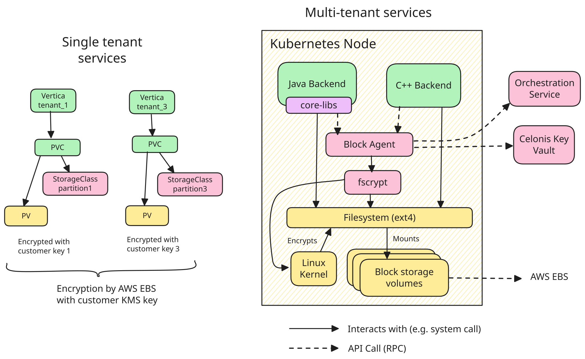

We implemented a
[DaemonSet](https://kubernetes.io/docs/concepts/workloads/controllers/daemonset/)
(which is a Pod running on every node) called Block Agent. This exposed a local
API (REST over a [Unix domain
socket](https://en.wikipedia.org/wiki/Unix_domain_socket)) to open and close a
directory for a tenant. Client libraries would do this automatically before
handing over a directory to the application, based on the SecurityContext. The
first time a tenant needed storage in a volume, the Block Agent would
temporarily mount the volume locally, fetch a data encryption key from [Celonis
Key Vault](#key-vault), store its encrypted version on the volume, and use it to
configure kernel-level encryption for a new directory. The application could
then use the directory normally. On backend restarts, all directories in the
volume are sealed, and therefore require valid access to the customer keys on
KMS. To ensure proper handling of root key rotations and revocations, the agent
periodically re-opens directories and re-encrypts their data keys. If the key is
no longer available, the directories become unusable (permanently, or
temporarily if the customer restores the key).

This setup had several advantages: It was language independent and easy to
adopt. It also introduced acceptable overhead (5% \- 10% IOPS drop on our
workloads), and finally came with built-in compliance. Given that all encryption
happened in the kernel, we inherited [FIPS
compliance](https://aws.amazon.com/compliance/fips/) from the [host
images](https://docs.aws.amazon.com/AWSEC2/latest/UserGuide/AMIs.html).

For single-tenant backends instead (like Vertica) we provided specific
per-partition [Storage
Classes](https://kubernetes.io/docs/concepts/storage/storage-classes/),
configured to use EBS with the customer-provided key. Backends provisioned for a
single tenant then had to use the proper pre-configured Storage Class, and
everything else would work the same.

## Postgres

For efficiency reasons, we use cloud-managed shared Postgres database instances
(e.g. one Aurora RDS cluster on AWS), in which each backend service gets a
dedicated logical database. This strikes some balance between isolation (each
service has its own view) and efficiency (resources are shared by backends).

Multi-tenancy was managed at the row level through a `tenant_id`
tenant-discriminator column per table. Java core libraries propagated the tenant
ID from the SecurityContext to queries transparently. This was done through
custom `@TenantId` annotations, equivalent to [Hibernate's
TenantId](https://docs.hibernate.org/stable/orm/javadocs/org/hibernate/annotations/TenantId.html),
and backed by a Hibernate filter that added a `WHERE` clause to queries
automatically.

We could have encrypted those rows transparently through a Postgres proxy, based
on the same discriminator (row-level encryption). Each row with user data would
have been encrypted before even reaching the database, similarly to [how the
RabbitMQ proxy](#rabbitmq) does it. This solution however breaks any query
relying on the contents of encrypted columns: sorting, filtering, manipulation,
because the execution of the query would still happen at the Postgres cluster,
and that would lose visibility into encrypted data.

We couldn't solve this on the proxy, as it would have meant semantically
understanding and rewriting queries on the fly (e.g. `WHERE x = 'foo'` becomes
`WHERE x = '<encrypted_foo>'`), which is a very hard problem to solve. But even
if that were doable, among other things, it wouldn't cover approximate queries
(e.g. `WHERE x LIKE 'foo%'`). Because, what do you set `foo%` to? Encrypted
`foo` is not a prefix of encrypted `foobar`. This would have meant turning those
queries into full scans.

Another possibility would have been to ask backend engineers to avoid forbidden
operators, or do more client-side filtering. The magnitude of this change was
however large and not transparent, and we had to discard it.

We also considered using
[Tablespaces](https://www.postgresql.org/docs/current/manage-ag-tablespaces.html)
and partitioning each table based on the tenant discriminator. Storage would
then be naturally separated by tenant and could be encrypted at rest separately,
using for example the [block storage solution](#block-storage). This would have
complicated schema management quite a lot, and also wouldn't solve for the fact
that the Postgres [Write-Ahead
Log](https://www.postgresql.org/docs/current/wal-intro.html) (WAL) is unified.
The last straw was that this would also have meant moving from cloud-managed to
self-managed Postgres clusters, which we were not prepared to do.

What we ended up using was [Pattern B](#patterns). It's no secret that database
encryption is best managed by databases themselves. We split the database
clusters into several partitions (one per CMEK customer). Each instance was then
encrypted at rest with the right customer key at the cloud provider level. To
route among those instances, we introduced a proxy (an internal version of an
open-source pooler) that speaks the Postgres wire protocol, provides connection
pooling and routes according to tenant context.

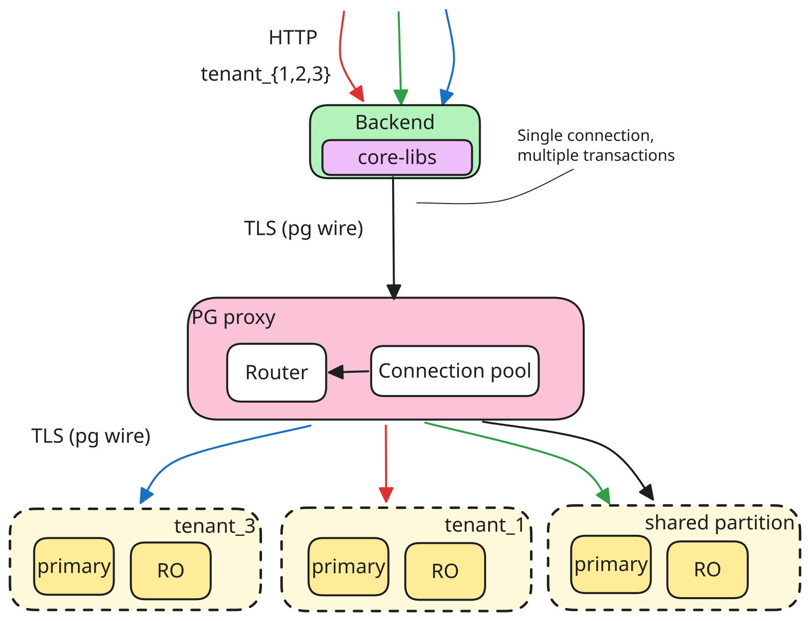

Of course then, each database cluster has the same list of logical databases,
the same schemas and the same tables. What changes is the _rows_ within each
table, as every partition only contains rows belonging to the associated
tenants.

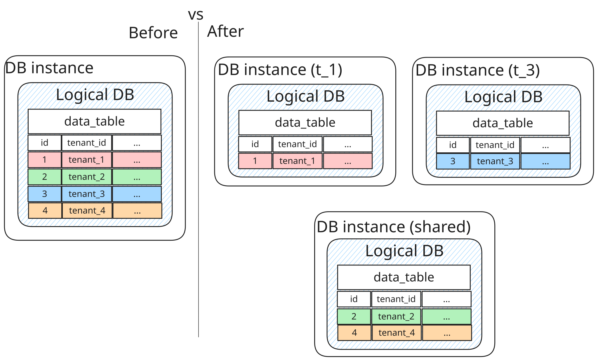

To make routing work transparently, we extended the core libraries so that when
a connection is taken from the pool, the library tells the proxy which tenant
the connection is serving. The proxy then routes all following queries on that
connection to the correct tenant's DB instance. This needed no custom protocol
and no full SQL parsing. The proxy only needs to keep the tenant-to-partition
mapping in memory.

This trick solved the vast majority of routing needs we had at the time, but not
all. We discovered a long tail of cases where multi-tenant queries were
necessary (e.g. old records cleanups, statistics). We initially thought of
providing a higher-level library functionality to iterate the same query over
all partitions, and rewriting those queries, but we would then also have lost
cross-partition atomicity. Automatic retries of failed queries are not safe in
general (i.e. idempotency is not always guaranteed), so instead of spending a
long time rewriting while taking significant risks, we decided to add a reserved
cross-tenant context (managed automatically through annotations) that routed to
all partitions through a sharding middleware based on an open-source project.

Besides routing, multiple instances also brought the challenge of schema
management. Whereas before, services could choose to use whatever mechanism they
wanted ([Flyway](https://github.com/flyway/flyway),
[Alembic](https://pypi.org/project/alembic/), custom one-time jobs, SQL scripts
at start-up, etc.), we had to become more restrictive, to ensure schemas stayed
in sync among all partitions. The good news was that centralizing schema
management was a good idea from many angles: no more manual schema migrations,
adding linting for common pitfalls and generally preventing many footguns (we've
seen some incidents related to bad schema management). This made the transition
largely welcomed by engineers, especially because it was automated and driven by
us. Onboarding was a GitHub workflow that took schema dumps from the live DBs
and rewrote them into a `schema.sql` suitable for [Atlas](https://atlasgo.io/)
in a central git repository. Migrations then became new SQL files with changes
from previous versions (through PRs). In production, we used a Kubernetes
operator that applies those changes to all partitions through
[Jobs](https://kubernetes.io/docs/concepts/workloads/controllers/job/).
Applications using our libraries check at startup that the schema version
returned by the live database corresponds to the one expected by the running
code (a simple version number check).

I'm mentioning only the biggest changes; we had to solve many more sub-problems.
For example:

- Tenant-agnostic data (i.e. that didn't belong to any specific tenant) stayed
  in the shared DB. How do you then join it with tenant data?
- The proxy became the single point of access towards databases. This provided
  additional benefits, such as better connection pooling, reduced memory usage
  on DBs, and better failover behavior.
- The proxy also became an enforcement funnel we could use to enforce better
  service isolation.
- The schema migration automation.
- Postgres "fleet management", or how do you manage, upgrade and scale database
  servers at scale?

I'm leaving these and other Postgres topics out of this article, but wanted to
give you an idea of the complexity behind this apparently simple feature.
Postgres was in fact the most complicated storage service to solve CMEK for.

## Object Storage

Unlike Postgres, which mainly hosts metadata, Object Storage stores our
customers' actual data, which is orders of magnitude larger. Hand-waving and
simplifying a lot, Celonis is a data pipeline where data is ingested and
processed from and to Object Storage in stages. Adding latency or lowering the
reliability of this path has a large impact, because it comes at a cost that is
multiplied by the number of steps in this pipeline. Besides the criticality,
services were a lot less uniform in the way they used Object Storage than they
were with Postgres. Some used our client-side libraries (Java and Python), while
others had bespoke libraries or directly used the cloud provider SDKs. Some
(e.g. Vertica) we could not really change, as they were highly optimized to use
Object Storage directly.

The idea of introducing a transparent proxy was the most appealing initially
(either [Pattern A or B](#patterns)), as clients would only need to change the
configured S3 endpoint, and the proxy would abstract the encryption concern
away, similarly to the Postgres solution. We liked it because it allowed the
most future flexibility behind a stable API.

Unfortunately, we had to discard _Pattern B_ (proxy to bridge), mainly because
of complications in addressing [request
signing](https://docs.aws.amazon.com/AmazonS3/latest/developerguide/RESTAuthentication.html)
(which prevents the proxy from rewriting the destination bucket without
re-signing the request). But more generally, we had to discard proxy-based
solutions because of bandwidth concerns (which would have required a large
deployment), and more importantly, the fact that Databricks (an alternative to
Vertica in our solutions) refused to use custom S3 API endpoints. Similarly,
Snowflake and bring-your-own-bucket integrations expect customers to connect to
an S3 bucket directly, and asking them to use custom endpoints would have broken
them.

We could have asked every client to set [client-side
encryption](https://docs.aws.amazon.com/AmazonS3/latest/userguide/UsingClientSideEncryption.html)
correctly per-tenant, but this was error-prone and would have caused a 100x
increase in KMS costs, because we couldn't then use [bucket
keys](https://docs.aws.amazon.com/AmazonS3/latest/userguide/bucket-key.html).

We went instead with a pragmatic client-side library \+ routing API approach
(_Pattern C_). Backend services using one of the libraries got the change for
free, and others could either use the routing API directly to map a tenant to
its assigned buckets, or pay at deployment time for dedicated single-tenant
instances.

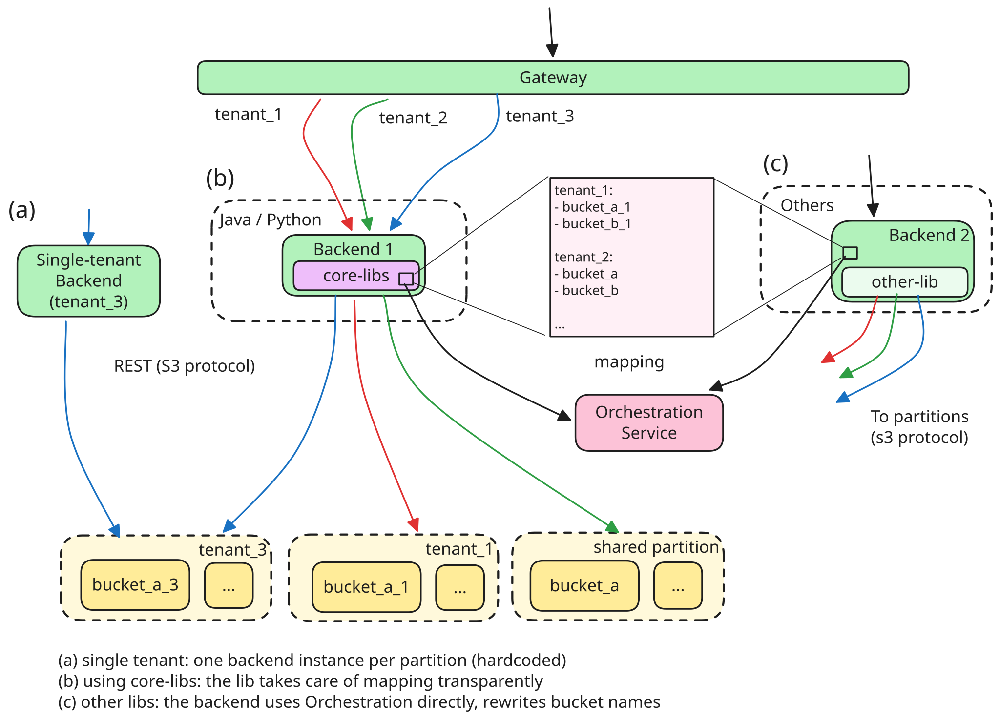

The core libraries in backends swap the bucket name in every request to S3 with
the appropriate one, by using the tenant ID in the
[SecurityContext](https://docs.spring.io/spring-security/reference/api/java/org/springframework/security/core/context/SecurityContext.html).
The mapping from tenants to buckets is maintained by the Orchestration service
([described below](#orchestration-automation)). The library simply fetches,
caches, and refreshes it on demand.

Single-tenant backends had to instead provision their service for every tenant
and configure each of them to use a different bucket. This is of course
sub-optimal, unless the service was already provisioned in this way.

As consequences of this decision:

1. We used [S3 bucket
   keys](https://docs.aws.amazon.com/AmazonS3/latest/userguide/UsingKMSEncryption.html#sse-kms-bucket-keys)
   in AWS to save on KMS costs (up to 99%), so we had to split buckets, rather
   than use client-side or path-based solutions.
2. Aggressive caching of the tenant mapping was necessary to trim latency. This
   applied to libraries and custom implementations as well.
3. Evolving the setup in the future didn't become easier, as clients are exposed
   to the implementation detail of "splitting data into multiple per-customer
   buckets".
4. Cloud-provider details are either exposed to clients or to services directly.
   There's no abstraction over object storage.

Exposing object storage details to backends was already a reality, because of
heavy usage of custom [lifecycle
policies](https://docs.aws.amazon.com/AmazonS3/latest/userguide/object-lifecycle-mgmt.html)
and [presigned
URLs](https://docs.aws.amazon.com/AmazonS3/latest/userguide/ShareObjectPreSignedURL.html),
which are inherently cloud-provider specific.

## Orchestration and automation {#orchestration-automation}

Before this project, we only needed new infrastructure during the spin-up of a
new environment, or when we carried out upgrades and improvements. Although
painful, these were happening at a pace where human involvement was possible.
This feature, however, drastically changed the picture, as we had to start
provisioning in response to tenant onboarding, which is automated and happens at
a very different scale.

The implication was that we had to be able to hot reload proxy configuration
and, more importantly, automate infrastructure provisioning and make it
hands-off. The good news was that we could roll out improvements and automation
incrementally, as the feature went from a pilot, to a private preview, to
becoming generally available.

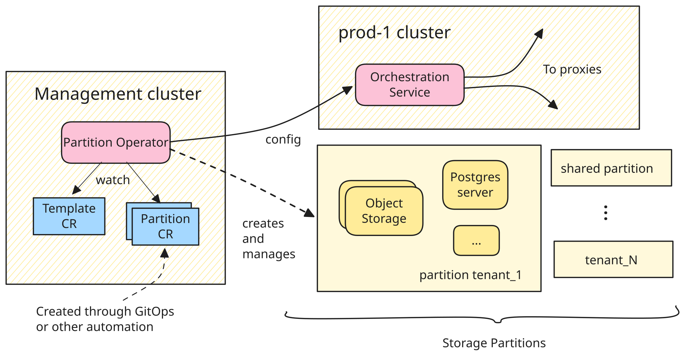

We opted for a [Kubernetes
operator](https://kubernetes.io/docs/concepts/extend-kubernetes/operator/)\-based
solution running on a management cluster already responsible for provisioning
some of our cloud infrastructure: the _Partition Operator_. This new operator is
responsible for creating and reconciling resources based on two Kubernetes
[Custom
Resources](https://kubernetes.io/docs/concepts/extend-kubernetes/api-extension/custom-resources/):
a template, defining _which resources_ each partition should have (the
`Template` CR), and a series of `Partition`s, enumerating _which partitions_
should be instantiated and which key to use for the encryption. This was
implemented as a regular Kubernetes operator that manages [Crossplane Managed
Resources](https://docs.crossplane.io/latest/managed-resources/managed-resources/).
This way we could easily add business logic and guardrails to the provisioning,
while delegating the actual act of provisioning to battle-tested Crossplane
providers, which we were already using.

After adding or removing partitions, the operator is then responsible for
communicating with the respective _Orchestration service_, which is responsible
for holding the configuration of an environment, providing APIs to query it and
coordinating changes to the proxies.

The link between a customer onboarding and a new partition initially required a
config change to our GitOps repository by a platform engineer, and is currently
being automated further, so that functions other than Engineering could execute
it through the default Celonis control plane.

# Impact

The impact of platform projects is normally measured through "cost savings" or
[COGS](https://en.wikipedia.org/wiki/Cost_of_goods_sold) metrics, so they just
move the denominator in the revenue-to-cost ratio. In business terms, this is
often referred to as "lowering the cost of revenue", or improving margins. It
turns out, however, that lowering costs by an order of magnitude moves the
numerator too (i.e. the revenue), because we could pass the savings down to
customers far enough to unlock a new market segment. This is not something I
have seen often, and it was certainly a nice surprise, because that alone easily
justifies the effort spent.

But let's get back to the 10x savings figure, and how that worked out.

A multi-tenant environment serving a hundred tenants costs the same order of
magnitude as a single-tenant one. Since costs are shared, in that environment a
customer is about 100x cheaper. To achieve our 10x cost reduction goal, we just
had to make sure to keep most of the expensive part of the stack (compute)
shared, and keep additional storage partitions (one per CMEK customer) cheap
enough. That cost is dominated by the extra RDS cluster, which is billed by the
instance. All other costs are either request-based (e.g. S3) or size-based (EBS)
and therefore don't change much when the storage is split across instances.
Without getting into specific numbers, a single RDS cluster is a small fraction
of a full dedicated instance, so the added cost left us well within the 10x
target reduction.

Provisioning followed a similar logic. We attached our infrastructure automation
to the existing tenant provisioning workflow, and even though ours is not yet
fully hands-off, staying within two days is already a 10x improvement over the
several weeks of a dedicated instance. Non-CMEK customers weren't affected at
all: their cost structure and provisioning process stayed the same.

# Conclusion and next steps

The journey from conception to launch took us around 18 months, and was a
compromise between ensuring stability of existing and new customers, and
enabling this new capability.

Although the project is a success, to get this done we had to cut corners that
we are now progressively smoothing out. For example, we're making infrastructure
provisioning truly hands-off, and plan to eliminate the need for cross-partition
Postgres queries (this requires changing backends).

Another simplification we made was focusing on _new customers_. Existing
customers that wanted the feature enabled have to go through a time-consuming
tenant-migration process, which is currently neither automated nor transparent.
Besides tackling that, we will have to redesign and get ready to 10x our current
limit of around a hundred CMEK tenants per environment, as we anticipate many
customers will want the feature enabled by that point.

On a personal note, I was lucky enough to be part of a talented and motivated
team, which made all of this possible. I strongly believe both of those
qualities are necessary to pull hard projects off: talent alone is not enough.
It takes focus to fix unforeseen issues, but also faith to see hard tradeoffs
through, while steering away from off-the-shelf solutions, which are the common
sense of our profession. There would be a lot more to say on this topic, but I
hope this already brings some value to you, fellow engineer, navigating complex
problems whose solution comes into sight only along the way.
